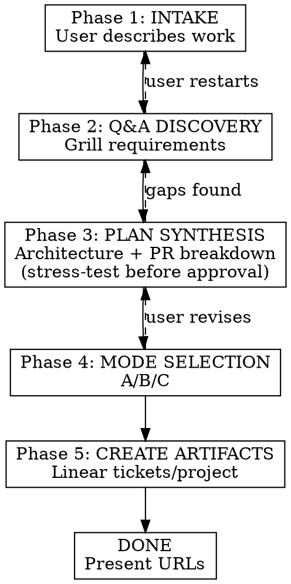

# /plan-work

Guide users through natural language → Q&A → structured plan → Linear artifacts.

Read `linear-patterns.md` in this skill directory before creating any Linear artifacts.

## Prerequisites

Linear MCP must be connected. If any Linear MCP call fails with a connection error, stop and tell the user to reconnect (`/mcp`).

## Workflow



---

## Phase 1: INTAKE

Accept the user's work description. This can be:

- Free-form natural language
- A Linear ticket URL (fetch with `get_issue`)
- A Linear document URL (fetch with `get_document`)
- A reference to code in the repo

Summarize your understanding back to the user in 2-3 short sentences. Capture the work at behavior-level — what's broken or what we're doing. Do **not** list fix options, evidence, or related cleanups in the intake summary; those surface in Phase 3 (plan synthesis). If the ticket has multiple sections (Problem / Evidence / Fix options / Related cleanup), the summary collapses all of them into "what the work is" — not a recap of the ticket structure.

**If the input is an existing Linear ticket**, ask how the user wants to proceed:

- **(a) Enrich it** — update the existing ticket with a fuller plan/description
- **(b) Break it down** — create child tickets or a project underneath it
- **(c) Use as inspiration** — plan net-new work informed by the ticket but not tied to it

This determines whether Phase 5 updates an existing ticket or creates new ones.

**Hard gate — why this is needed:** before moving to Q&A, you need a concrete answer to *why this work is needed*. This is not optional — downstream agents (cloud agents, future you, reviewers) implement the work based on this why, so getting it accurate matters more than getting it fast.

1. **Glean first.** Read the input (ticket body, document, natural-language description) and try to extract the why.
2. **Always double-check with the creator.** Even if the input has a clear why, surface it back: "I read the why as: {summary}. Is that the real driver, or is there context behind it?" Wording in tickets can be stale, abbreviated, or written for a different audience — the person invoking /plan-work is your source of truth, not the ticket text.
3. **If nothing to glean, ask outright.** If the input is silent or vague, ask: "why is this needed? who's asking, what can't they do today, what's the cost of not doing it?"
4. **Reject vague motivations.** "Tech debt", "we should clean this up", "would be nice" are not answers. Push for a user/workflow/metric and the consequence of inaction.
5. **Stay within this ticket.** Do not pull context from sibling, parent, child, or future tickets even if linked. The why must be self-contained to the work in front of you — anything else is scope creep into someone else's plan.

Capture the confirmed result verbatim — it becomes the `## Why this is needed` section of the ticket and the source of truth for whoever implements it.

**Hard gate — summary:** confirm your summary is correct before moving to Q&A. Ask: "is this the right read, or am I missing something?"

---

## Phase 2: Q&A DISCOVERY (GRILL)

This is a grilling session, not a survey. Interview the user relentlessly about every aspect of the work until you reach genuine shared understanding. Walk down each branch of the decision tree, resolving dependencies between decisions one-by-one — don't open a new branch while an earlier one is still fuzzy.

**Depth scales with the work.** A one-PR change might resolve in a handful of questions; a large multi-ticket project can legitimately run dozens. Going deep on big work is the skill functioning correctly, not overstaying — let the size and risk of the work set the length of the interview, and don't rush to wrap up a large plan.

**Grilling discipline:**

- Ask questions **one at a time**, and wait for the answer before asking the next. Never batch.
- For every question, **provide your recommended answer** and a one-line why. Prefer multiple-choice framings, but a recommendation is mandatory even when open-ended.
- **Explore the codebase instead of asking** whenever a question can be answered by reading code, tests, or AGENTS.md. Don't make the user tell you what the repo already knows.
- **Escalate fact-dependent forks to an investigation subagent.** When grilling surfaces a decision with multiple viable options *and* the right call hinges on facts you don't have yet — how the code actually behaves, what a dependency supports, what prior art exists — don't make the user arbitrate blind. Spin up a subagent to investigate, then come back with options grounded in its findings, each with its tradeoff and your recommendation. Reserve this for consequential, genuinely uncertain forks; a quick grep you can do inline doesn't need a subagent.
- **Sharpen fuzzy language.** When the user uses a vague or overloaded term, propose a precise canonical term and pin it down. "You said 'account' — do you mean the Organization, the User, or the billing Account? Those are different things here."
- **Cross-reference with code.** When the user states how something works, check whether the code agrees. If you find a contradiction, surface it immediately: "You said partial cancellation is possible, but the code only cancels whole records — which is right?"
- **Stress-test with concrete scenarios.** When domain relationships or edge cases come up, invent a specific scenario that probes the boundary and force a precise answer. Don't accept hand-waving.
- **Capture decisions as they crystallize** — terminology, chosen approach, rejected alternatives, and the why. You're collecting them now; they become ticket content in Phase 5 (for net-new work there's no ticket yet). See `linear-patterns.md` ("Where grilled decisions go") for where each kind lands. Plan decisions live in the ticket, not in ADRs or a CONTEXT.md.

Focus areas:

- **Why this is needed (deepen):** if Phase 1 only got a one-liner, dig further with the user — who specifically is asking, what workflow/metric is affected, what's the urgency driver (incident, deal at risk, compliance, perf SLO, ongoing pain). Ask the user; do not infer from sibling/parent/child tickets.
- **Requirements:** what exactly needs to happen? edge cases?
  - If user-facing: who is the user persona? what's the desired flow/experience?
- **Prioritization:** which parts are must-haves vs nice-to-haves?
- **Constraints:** backward compatibility, performance, security, compliance, accessibility (if frontend)
- **Scope:** what's explicitly out of scope?
- **Verification:** checks proportional to risk; bias tests toward router/API, database, public-contract, and external boundaries, and skip ambiguous low-value tests without asking
- **PR structure:** can this be one PR or does it need multiple?
- **Team/assignee:** who should own this? (default: unassigned)
- **Existing context:** related tickets, prior art, relevant AGENTS.md

**Hard gate:** do NOT move to Phase 3 until the user explicitly confirms requirements are complete. Ask: "does this cover everything, or is there more to add?"

---

## Phase 3: PLAN SYNTHESIS

Produce a structured plan covering:

1. **Architecture decisions** — what approach, why, what alternatives were considered
2. **File changes per PR** — which files to create/modify, what each change does
3. **Verification strategy per PR** — existing checks, direct browser/runtime/manual verification, and high-value automated tests where the risk warrants them
4. **PR ordering** — dependency graph, what must land before what
5. **Risk areas** — what could go wrong, what needs careful review

Present the plan to the user. Iterate until they approve.

For single-PR work, this can be brief (a few paragraphs). For multi-PR projects, each PR gets its own section.

**Stress-test before approval (GRILL).** Don't let the plan be rubber-stamped. Before asking for sign-off, attack your own synthesis the way grill-me would attack a design:

- **Walk a concrete scenario end-to-end** through the proposed change. Pick the gnarliest realistic input — the edge case, the failure path, the concurrent-write, the half-migrated state — and trace it through the PRs. If the plan breaks or gets vague, you found a gap. Fix it before presenting, or surface it as an open question.
- **Re-check the plan against the code.** Verify the file paths, patterns, and integration points you cited actually exist and behave as assumed. A plan that contradicts the codebase is worse than no plan.
- **Probe the PR seams.** For multi-PR plans, ask whether each PR is independently shippable and revertible, and whether the ordering survives one PR slipping. Name what breaks if PR N lands without PR N-1.
- **Name the thing most likely to be wrong.** State your single biggest uncertainty out loud and get the user to confirm or correct it — don't bury it in the risk section.
- **Investigate forks before presenting them.** When a stress-test exposes a gap with several defensible resolutions and choosing well needs facts, dispatch a subagent to dig in and bring back an analyzed option set — don't hand the user an unexamined choice.

Carry resolved decisions and rejected alternatives into the ticket content you'll write in Phase 5, per `linear-patterns.md`.

---

## Phase 4: MODE SELECTION

Based on the plan, recommend one of three modes:

### Mode A: Single Ticket

- Plan has 1 PR
- Isolated change, no cross-cutting concerns
- Create one ticket (optionally on an existing project)

### Mode B: Add to Existing Project

- Plan has 2+ PRs
- Work belongs to a known initiative
- Steps:
  1. Query `list_projects` to find active projects
  2. Present candidate projects to user
  3. User picks one, or says "none of these" → fall back to Mode C

### Mode C: New Project

- Plan has 2+ PRs
- Work is a new initiative with no existing project home
- Create a new project, then create tickets within it
- Ask: "does this project belong to an existing initiative? linking it helps with prioritization"

**Always present your recommendation and let the user confirm or override.**

For Mode A, also ask: "should this ticket live under an existing project, or standalone?" If the user picks a project, query `list_projects` to find it.

---

## Phase 5: CREATE LINEAR ARTIFACTS

### Setup (all modes)

1. Get the team ID: `list_teams` (ask the user which team if there's more than one)
2. Get available labels: `list_issue_labels`
3. Get available statuses: `list_issue_statuses`

### Mode A: Single Ticket

1. `save_issue` with:
   - Title: concise, conventional-commit-style (e.g. "feat: add user onboarding flow")
   - Description: full ticket template from `linear-patterns.md`
   - Team ID, labels, status (default: Backlog)
   - Project ID if user chose one
2. Present the ticket URL

### Mode B: Add to Existing Project

1. For each PR in the plan (ordered by dependency):
   - `save_issue` with project ID, full ticket template
   - Include multi-ticket additions (PR N of total, previous/next context)
2. Set blocking relationships between tickets using the issue relation fields
3. Present all ticket URLs with the dependency order

### Mode C: New Project

1. `save_project` with:
   - Name and description per `linear-patterns.md` project template
   - Team IDs
2. For each PR in the plan (ordered by dependency):
   - `save_issue` with project ID, full ticket template
   - Include multi-ticket additions
3. Set blocking relationships between tickets
4. Present project URL and all ticket URLs with dependency order

### After creation

Present a summary:

```
Created:
- [Project: {name}]({url})  ← only for mode C
- [{ticket title}]({url}) — {status}
  └ blocks: {blocked ticket IDs}
```

Ask: "does this look right? I can update any ticket or add more."

---

## Revision Handling

At any phase, if the user says something like "actually", "go back", "wait", or "change":

- Identify which phase needs revision
- Go back to that phase
- Re-execute from there

If a created ticket needs updating, use `save_issue` with the existing issue ID to update it.

---

## Linear MCP Tools Reference

| Tool                  | Used for                              |
| --------------------- | ------------------------------------- |
| `list_teams`          | Get team ID                           |
| `list_projects`       | Find existing projects (mode B)       |
| `list_issue_labels`   | Available labels                      |
| `list_issue_statuses` | Available statuses                    |
| `save_project`        | Create project (mode C)               |
| `save_issue`          | Create/update tickets                 |
| `get_issue`           | Verify created tickets                |
| `get_document`        | Fetch Linear doc if user provides one |
